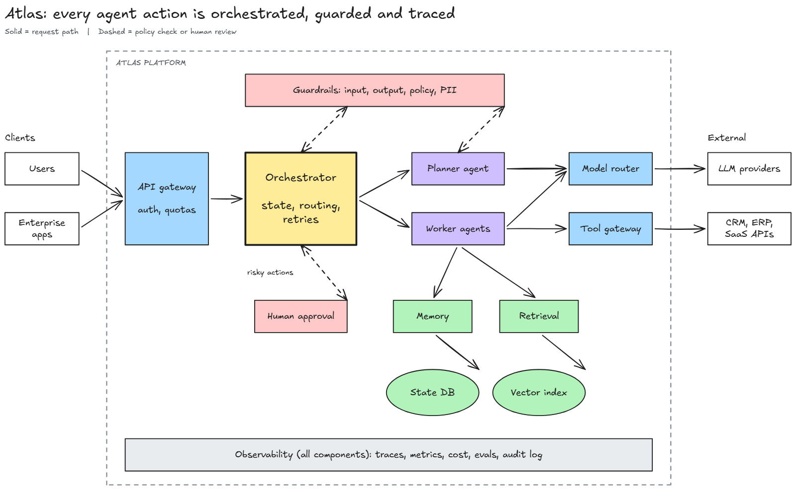
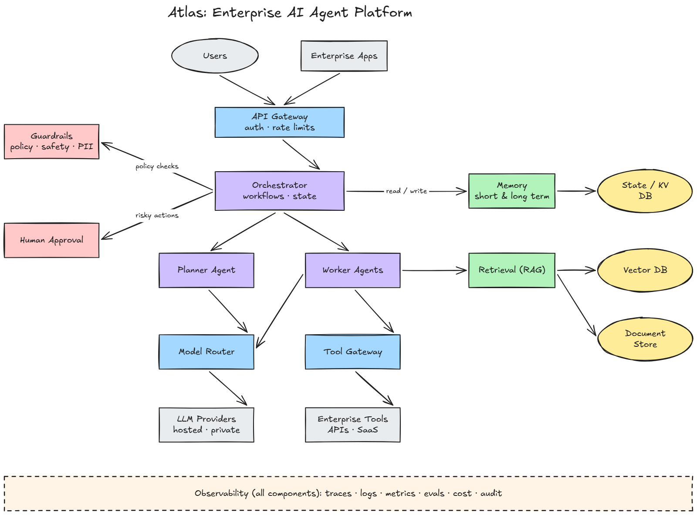
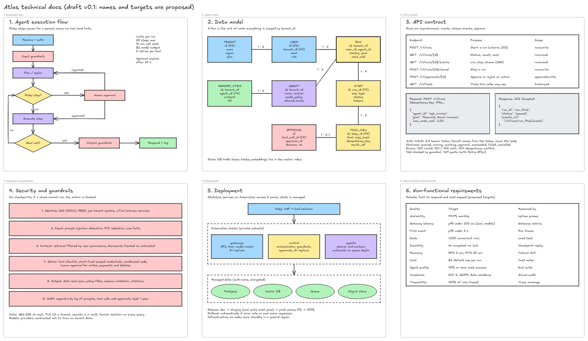
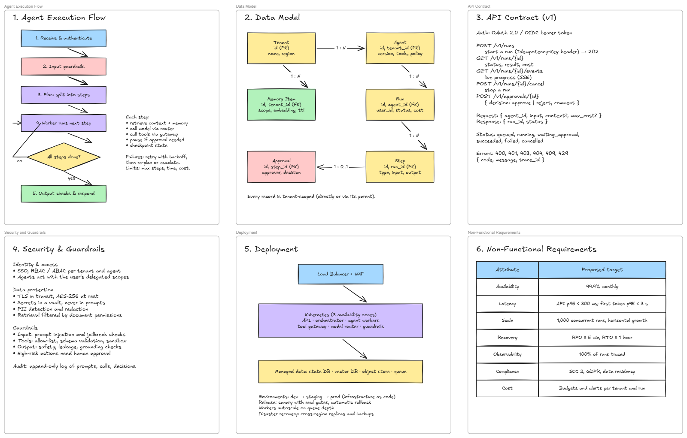
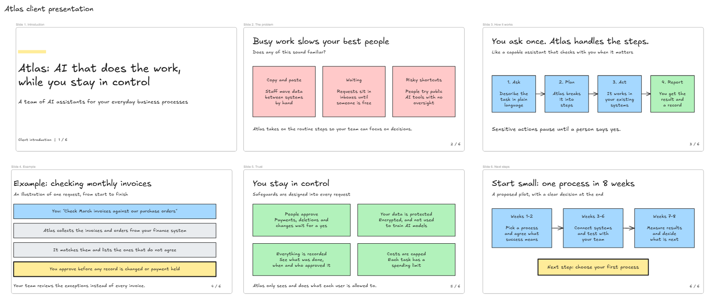
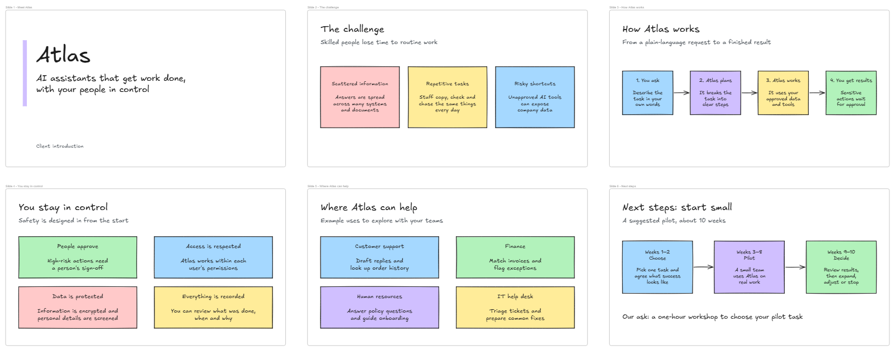

# Default skills: with and without

Project **Atlas**, an AI agentic platform. Claude (`claude-sonnet-5-5`) got the same three requests twice: with the panel instructions including the skills, and with the skills removed. One run each, so treat small differences as chance.

## Open the scenes

Drag a file onto the canvas:

- [With skills](out/atlas-with-skills.excalidraw)
- [Without skills](out/atlas-without-skills.excalidraw)

Each holds the architecture, six technical document frames and six client slides.

## Verdict

The content and the story improved clearly. How the connectors are built got worse.

| Part | Result with skills |
| --- | --- |
| Architecture | Better: headline states the takeaway, left-to-right flow, one focal point, legend, platform boundary. Without skills it kept a document store and more arrow labels. |
| Technical documents | Clearly better: fuller execution flow, data model with 7 entities instead of 6, API table with request and response examples, targets with how to measure them. Text is denser. |
| Client slides | Slightly better: headlines that say something, a worked invoice example, slide numbers, consistent colour meaning. Slides 1 and 4 are out of line with the others. |

## Measurements

| Measure                             | With     | Without  |
| ----------------------------------- | -------- | -------- |
| Elements                            | 266      | 220      |
| Words on canvas                     | 992      | 744      |
| Frames                              | 12       | 12       |
| Overlapping shapes or clashing text | 0        | 0        |
| Arrows attached to both shapes      | 12 of 42 | 32 of 35 |
| Arrows with attached labels         | 0        | 8        |
| Arrows crossing an unrelated shape  | 3        | 0        |
| Items spilling out of a frame       | 1        | 0        |
| Different font sizes                | 8        | 12       |
| Output tokens                       | 19,970   | 13,469   |
| Generation time                     | 137 s    | 94 s     |

The crossing check covers arrows only; the run without skills has a loop drawn as a line that cuts through a box in its execution flow.

## Problems found

1. **App bug, both runs:** perfectly vertical arrows come out slanted. `convertToExcalidrawElements` reads `width: 0` as "no width" and uses 100 (`packages/element/src/transform.ts`, the `arrow` case), and `ClaudePanel/sceneOps.ts` produces `width: 0` for shapes on a shared centre. The Excalidraw skill asks for shared centres, so it triggers this.
2. **Skill wording:** with skills, the technical documents and slides used hand-placed arrows and loose text labels, so they don't move with their shapes. The skill should require `start` / `end` ids and arrow `label`.
3. **Invented facts, both runs:** targets, compliance claims, pilot length and data promises are made up. Confirm them before showing a client.

## Pictures

### Architecture

| With                        | Without                           |
| --------------------------- | --------------------------------- |
|  |  |

### Technical documents

| With                        | Without                           |
| --------------------------- | --------------------------------- |
|  |  |

### Client slides

| With                        | Without                           |
| --------------------------- | --------------------------------- |
|  |  |

## Run it again

```bash
node skills-eval/run.mjs with
node skills-eval/run.mjs without
```

This regenerates `out/<variant>.json` using your Claude plan. The scenes and pictures above were exported from the running app and are not rebuilt by these commands.
